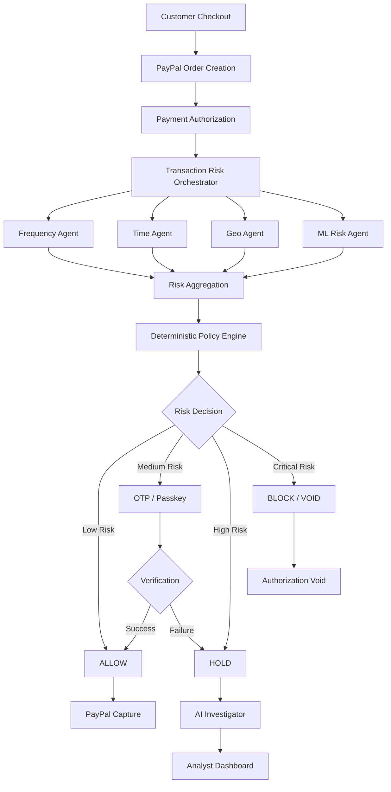

# PayPal Shield AI 🛡️
### Intelligent Risk. Seamless Payments. Secure Transactions.

**An AI-powered, multi-agent payment security system that detects suspicious transactions, applies adaptive authentication, and controls payment capture through explainable and deterministic risk decisions.**

<p align="center">
  
  
  
  
</p>

---

## 🚀 Overview

Traditional payment fraud detection systems often face a critical trade-off: overly restrictive security measures inconvenience legitimate customers, while lenient systems expose merchants to fraudulent transactions.

**PayPal Shield AI** addresses this challenge through an intelligent, multi-agent risk assessment architecture that evaluates transactions before payment capture.

The system combines behavioural intelligence, machine learning (for supported transaction datasets), deterministic policy enforcement, adaptive authentication, and AI-assisted investigation to make payment decisions more explainable and controlled.

Instead of applying authentication challenges to every customer, Shield AI introduces risk-based security:

- Low-risk transactions → ALLOW
- Medium-risk transactions → REQUEST_2FA
- High-risk transactions → HOLD for investigation
- Critical-risk transactions → BLOCK / VOID authorization

The objective is simple: **maximize payment security while minimizing unnecessary friction for legitimate customers.**

## 💡 Key Features

### 1. Multi-Agent Risk Intelligence

Independent agents evaluate different transaction dimensions:

| Agent | Responsibility |
|---|---|
| Frequency Agent | Detects abnormal transaction frequency and suspicious account activity |
| Time Agent | Identifies unusual transaction timing patterns |
| Geo Agent | Evaluates geographical inconsistencies and location anomalies |
| ML Risk Agent | Uses a trained fraud classification model for supported PaySim transactions |

Each applicable agent generates a risk score and human-readable explanations.

### 2. Deterministic Risk Policy Engine

Agent outputs are aggregated by a deterministic policy engine.

The policy engine translates transaction risk into an actionable payment decision:

| Risk Level | Decision | Payment Handling |
|---|---|---|
| Low | ALLOW | Eligible for capture |
| Medium | REQUEST_2FA | Step-up verification |
| High | HOLD | Analyst investigation |
| Critical | BLOCK | Authorization voided where applicable |

The policy engine, rather than an LLM, controls payment decisions.

### 3. Adaptive Authentication

Shield AI applies additional verification only when transaction risk justifies it.

- OTP-based verification
- WebAuthn / Passkey authentication
- Verification failure handling
- Risk-based step-up authentication

This approach aims to reduce unnecessary authentication friction.

### 4. AI-Powered Fraud Investigation

An AI Investigator analyzes the transaction evidence, agent scores, and risk explanations.

It produces:

- Transaction risk summaries
- Suspicious behavioural patterns
- Explainable investigation reports
- Recommended analyst actions

**Important:** The investigator is advisory. It does not independently authorize, capture, or void payments.

### 5. PayPal Payment Integration

The application is designed around PayPal's authorization-to-capture workflow.

- PayPal JavaScript SDK checkout
- Orders API v2
- Payments API v2
- Authorization and capture workflow
- Authorization voiding
- Idempotency protection
- Sandbox payment testing

The payment lifecycle is designed so that capture is gated by the risk policy decision.

### 6. Analyst Dashboard

The dashboard provides transaction-level visibility into:

- Transaction risk scores
- Agent-level explanations
- Payment decisions
- Investigation status
- Authentication outcomes
- Transaction history

## 🏗️ System Architecture



## 🔄 Transaction Processing Workflow

1. Customer initiates a payment through the demo store.
2. PayPal creates an order and authorizes the payment.
3. The transaction is passed to the risk orchestration layer.
4. Applicable agents independently evaluate behavioural and transaction signals.
5. The deterministic policy engine aggregates risk scores.
6. The system determines whether to allow, challenge, hold, or block the transaction.
7. Medium-risk transactions undergo additional authentication.
8. High-risk transactions are presented for analyst investigation.
9. Payment capture or authorization voiding is performed according to the applicable policy.
10. The decision and its explanations are recorded for auditability.

## 🧠 Machine Learning & Fraud Detection

Shield AI includes an ML development pipeline for PaySim-based fraud analysis.

The proposed ML pipeline includes:

- Temporal train, validation, and test splits.
- Transaction-level feature engineering.
- Gradient-boosted classification using XGBoost.
- Logistic Regression and Random Forest baselines.
- Probability calibration.
- Validation-based decision threshold selection.
- Feature importance and SHAP-based explainability.

### Feature Engineering

Features include:

- Transaction amount and log amount
- Transaction type
- Origin and destination balance differences
- Account drainage indicators
- Destination transaction history
- Unique sender patterns
- Simulated time-derived features

Fraud labels are used only as training targets and for offline evaluation, never as inference-time inputs.

**Dataset:** PaySim synthetic mobile money transaction dataset.

**Important:** The PaySim ML pipeline and live PayPal checkout have different input schemas. The ML Risk Agent is applicable only to supported PaySim-format transactions unless a suitable live-payment feature mapping is implemented and validated.

### Evaluation Metrics

Model performance must be evaluated using:

| Metric | Purpose |
|---|---|
| Precision | How many flagged transactions are actually fraudulent |
| Recall | How many fraudulent transactions are detected |
| F1-score | Balance between precision and recall |
| PR-AUC | Performance under severe class imbalance |
| ROC-AUC | Ranking ability across thresholds |
| False Positive Rate | Legitimate transactions incorrectly flagged |
| Challenge Rate | Share of legitimate transactions requiring additional verification |
| Fraud Amount Caught | Value of fraud identified relative to total fraud value |

Results will be published only after a reproducible temporal test evaluation.

## 🛠️ Technology Stack

| Layer | Technologies |
|---|---|
| Frontend | Next.js, React.js, TypeScript |
| Backend | Python, FastAPI |
| Database | MySQL |
| AI / Agents | Multi-agent architecture, LLM-based investigation |
| Machine Learning | XGBoost, Scikit-learn, SHAP |
| Payment Integration | PayPal Orders API v2, Payments API v2, PayPal JS SDK |
| Authentication | OTP, WebAuthn, Passkeys |
| Data Processing | Pandas, NumPy |
| Visualization | AG Grid, analytics dashboard |
| Streaming | Apache Kafka (optional background processing) |
| Testing | Pytest, PayPal Sandbox |

## 📁 Project Structure

```text
paypal-shield-ai/
│
├── agents/
│   ├── frequency_agent.py
│   ├── time_agent.py
│   ├── geo_agent.py
│   ├── ml_agent.py
│   └── investigator_agent.py
│
├── ml/
│   ├── data.py
│   ├── features.py
│   ├── train.py
│   ├── model.joblib
│   ├── feature_names.json
│   ├── thresholds.json
│   └── MODEL_CARD.md
│
├── backend/
│   ├── orchestrator.py
│   ├── policy.py
│   ├── config.py
│   ├── evaluate.py
│   └── routes/
│
├── frontend/
│   ├── app/
│   │   ├── shop/
│   │   ├── story/
│   │   └── dashboard/
│   ├── components/
│   └── public/
│
├── docs/
│   ├── architecture.md
│   ├── MODEL_RESULTS.md
│   └── shap_summary.png
│
├── results/
│   ├── metrics.json
│   └── ablation.csv
│
├── scripts/
│   ├── e2e_sandbox.py
│   ├── seed_demo_profiles.py
│   └── update_readme_metrics.py
│
├── tests/
│   ├── test_agents.py
│   ├── test_policy.py
│   ├── test_ml_features.py
│   └── test_payments.py
│
├── .github/
│   └── copilot-instructions.md
│
├── .env.example
├── .gitignore
├── requirements.txt
└── README.md
```

*Note: This is the target logical structure. Adjust paths and module names to match the actual implementation; do not create placeholder modules merely to imply they are implemented.*

## ⚙️ Installation & Setup

### Prerequisites

- Python 3.10+
- Node.js 20+
- MySQL
- PayPal Developer account
- PayPal Sandbox buyer and business accounts

### 1. Clone the Repository

```bash
git clone https://github.com/YOUR_USERNAME/paypal-shield-ai.git

cd paypal-shield-ai
```

### 2. Backend Setup

```bash
python -m venv venv

# Windows
venv\Scripts\activate

# Linux / macOS
source venv/bin/activate

pip install -r requirements.txt
```

### 3. Frontend Setup

```bash
cd frontend

npm install
```

### 4. Environment Configuration

Create a `.env` file using `.env.example` as a reference.

Configure the required values:

```env
DATABASE_URL=

PAYPAL_CLIENT_ID=
PAYPAL_CLIENT_SECRET=
PAYPAL_BASE_URL=https://api-m.sandbox.paypal.com

LLM_API_KEY=

PAYSIM_CSV=
```

Never commit actual credentials, API keys, database passwords, or private datasets.

### 5. Run the Application

Start the backend using the project's configured FastAPI entry point:

```bash
uvicorn main:app --reload
```

Start the frontend:

```bash
cd frontend
npm run dev
```

Open:

```text
http://localhost:3000
```

*Adjust the backend entry point and commands if your actual repository uses a different configuration.*

## 🧪 Testing & Reproducibility

Run the automated test suite:

```bash
pytest -q
```

For the PaySim ML pipeline, after configuring `PAYSIM_CSV`:

```bash
python ml/train.py
python evaluate.py
```

For PayPal Sandbox end-to-end testing:

```bash
python scripts/e2e_sandbox.py
```

Use sandbox accounts and test credentials only.

## 📊 Results & Performance

Model performance and transaction-level evaluation should be reported using the latest reproducible test run.

The published results should include:

- Temporal test-set size and fraud base rate.
- Precision, recall, F1 and PR-AUC.
- False-positive and legitimate-customer challenge rates.
- Fraud amount detected.
- Confusion matrices.
- Per-agent and combined-policy comparisons.
- Inference latency.

**No verified benchmark numbers are claimed in this README yet.** Results will be added from the reproducible evaluation pipeline once the final test run is complete.

## 🔐 Security & Responsible AI

- Deterministic policy enforcement for financial decisions.
- AI investigator restricted to advisory responsibilities.
- No fraud-label leakage into inference.
- Idempotency protection for payment operations.
- Sandbox-first payment testing.
- Environment-based secret management.
- Human oversight for high-risk investigations.
- Auditable transaction decisions.

## 🌍 Potential Real-World Impact

PayPal Shield AI is designed to address three important stakeholders:

**For Merchants**
- Better visibility into payment risk.
- Controlled authorization and capture.
- Reduced exposure to suspicious transactions.

**For Customers**
- Risk-based authentication rather than blanket verification.
- Smoother low-risk payment experiences.
- Additional protection against suspicious activity.

**For Fraud Analysts**
- Explainable risk assessments.
- Consolidated transaction evidence.
- AI-assisted investigation summaries.
- Human-controlled final decisions.

## ⚠️ Limitations & Future Scope

Current development and evaluation have important limitations:

- PaySim is a synthetic dataset and does not represent the complete complexity of real payment fraud.
- PaySim timestamps are simulated.
- Geolocation signals in the demo are simulated.
- The ML model's applicability is limited to supported PaySim-format transaction data.
- Offline benchmark performance must not be interpreted as real-world PayPal fraud prevention performance.
- Real-world deployment would require production-grade data, monitoring, calibration, security reviews, and integration validation.

### Future Enhancements

- Real-time device fingerprinting and IP intelligence.
- Merchant-specific adaptive risk policies.
- Streaming fraud detection with Kafka.
- Advanced account-linkage and mule-network detection.
- Production-grade model monitoring and drift detection.
- Webhook-driven payment lifecycle synchronization.

## 🏆 Hackathon Project

**Built for the PayPal AI Hackathon**

Our vision is to make digital payments safer without making them harder.

**PayPal Shield AI — Security that adapts to risk, not the other way around.**

---

## 👩‍💻 Contributors

Add your team members and their GitHub profiles here.

- Project Lead: YOUR NAME
- Team Member: NAME
- Team Member: NAME

---

## 📄 License

Choose and add an appropriate open-source license before publishing. For example, MIT License, if all dependencies and project assets permit it.
