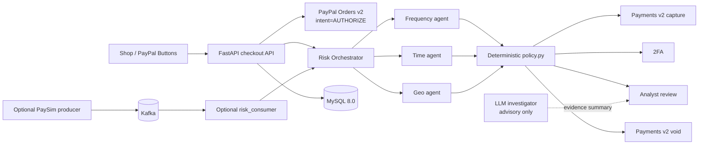

# PayPal Shield AI

PayPal Shield AI is a real PayPal Sandbox payment flow with a deterministic fraud-risk engine inside it: a buyer checks out in the Shop, PayPal authorizes the order, three independent agents score the payment, and a fixed policy decides whether to capture, request 2FA, hold for review, or void. An advisory investigator can summarize evidence for an analyst, but it never changes policy and never moves money.

## Screenshots

Add submission screenshots here:

- `docs/screenshots/shop.png` - PayPal Sandbox shop and risk result
- `docs/screenshots/live.png` - Live event ledger and analyst queue
- `docs/screenshots/story.png` - Risk story and detector explanation

## Architecture



## Judge Setup

1. Install Python dependencies: `..\.venv\Scripts\python.exe -m pip install -r requirements.txt`.
2. Install frontend dependencies: `Set-Location frontend; npm install`.
3. Create `.env` from `.env.example`; keep PayPal client credentials and LLM keys only in `.env`.
4. Create a PayPal Developer Sandbox app and record its client ID and secret. Create or use the default Sandbox buyer and business accounts.
5. Set `PAYPAL_MODE=sandbox`, `PAYPAL_CLIENT_ID`, `PAYPAL_CLIENT_SECRET`, `MYSQL_*`, `DEV_MODE=true`, and `LITE_MODE=true`. Set `DEMO_HOME_COUNTRY` and, when available, `DEMO_BUYER_PAYER_ID` for the seeded buyer profile.
6. Initialize MySQL: `..\.venv\Scripts\python.exe setup_db.py`.
7. Seed the buyer baseline: `..\.venv\Scripts\python.exe scripts\seed_demo_profiles.py --reset`.
8. Start the Kafka-free path: `powershell -ExecutionPolicy Bypass -File .\start_lite.ps1`.
9. Open `http://localhost:3000/shop`, choose a product, and use the PayPal Sandbox buyer login in the approval popup. API docs are at `http://localhost:8000/docs`.

For the optional PaySim stream, set `LITE_MODE=false`, start Kafka/ZooKeeper, and use `start_all.ps1`. The stream is not required for the PayPal checkout path.

## PayPal APIs Used

| API | Endpoint | Purpose |
|---|---|---|
| OAuth 2.0 | `POST /v1/oauth2/token` | Obtain a Sandbox access token |
| Orders v2 | `POST /v2/checkout/orders` | Create an order with `intent=AUTHORIZE` |
| Orders v2 | `GET /v2/checkout/orders/{id}` | Read order and approval details |
| Orders v2 | `POST /v2/checkout/orders/{id}/authorize` | Authorize the buyer-approved order |
| Payments v2 | `GET /v2/payments/authorizations/{id}` | Read authorization state |
| Payments v2 | `POST /v2/payments/authorizations/{id}/capture` | Capture only after a permitted decision |
| Payments v2 | `POST /v2/payments/authorizations/{id}/void` | Void blocked or analyst-blocked payments |

Sandbox base URL: `https://api-m.sandbox.paypal.com`. Currency is USD. Every mutating request uses an idempotency key.

## AI Tools

- The Frequency, Time, and Geo agents are deterministic Python modules with explicit feature calculations.
- `policy.py` is the only source of payment actions; the LLM never changes an action.
- `api/investigator.py` can use Gemini or Anthropic when configured with `LLM_PROVIDER` and `LLM_API_KEY`.
- The investigator receives fixed backend context, treats payer fields as untrusted delimited data, validates strict JSON, retries once, and falls back to a deterministic template when no key is available.
- `ai_agent.py` remains an evaluation/read-only SQL tool and is not part of real-time payment scoring.

## Deterministic Policy Choice

The policy is deliberately transparent and reproducible. It combines the three scores, then applies fixed thresholds:

| Score | Action | Payment path |
|---:|---|---|
| `< 40` | `ALLOW` | Capture |
| `40-69` | `REQUEST_2FA` | Verify, then capture |
| `70-89` | `HOLD_FOR_REVIEW` | Analyst approves or blocks |
| `>= 90` | `BLOCK` | Void authorization |

This keeps the money-moving decision auditable and prevents a model from silently changing a financial action.

## Lite Mode and Stream Mode

`LITE_MODE=true` is the recommended PayPal demo path. It requires only MySQL, FastAPI, and the Next.js frontend. `start_lite.ps1` runs `setup_db.py`, the API, and the frontend; it does not start Kafka, ZooKeeper, `risk_consumer.py`, `producer.py`, or Streamlit.

Kafka, `risk_consumer.py`, and `producer.py` are optional background infrastructure for the PaySim stream. They are useful for the live event story, but checkout orders are scored directly by the API and do not depend on Kafka.

## Sandbox E2E Script

After starting Lite mode and configuring a Sandbox buyer, run:

```powershell
..\.venv\Scripts\python.exe scripts\e2e_sandbox.py
```

The script prints an approval link for each scenario and waits for the default Sandbox buyer to approve it. It then verifies:

- Normal payment -> `CAPTURED`
- High-risk demo override -> 2FA -> `CAPTURED`
- Three wrong OTPs -> `PENDING_REVIEW` -> analyst `BLOCK` -> `VOIDED`
- PayPal `INSTRUMENT_DECLINED` mock -> graceful `FAILED`

## Limitations

- PaySim has no real timestamps or locations; stream data and demo overrides are explicitly simulated.
- The PayPal integration is Sandbox-only and uses a manual Sandbox buyer approval step.
- Country-only geo checks skip distance and impossible-travel calculations.
- LLM investigation is advisory and optional; it does not replace deterministic policy or analyst review.
- Production deployment still needs managed secrets, observability, and stronger authentication around analyst operations.

## What I added after Oct 1, 2026

Grounded in the repository history since October 1, 2026:

- Deterministic Frequency, Time, and Geo agents plus the orchestrator and policy engine (`4a85946`, `e5ca99c`, `202ffd2`, `e9f4e80`).
- FastAPI risk API and database-backed 2FA flow (`1a74995`, `a61ab7b`).
- PaySim scenario injection and offline evaluation (`1704f26`).
- Transaction story ledger and scroll-driven story (`d79417d`, `975bcd2`).
- Live command center, SSE feed, locations map, and review queue (`ec6c061`).
- Interactive fraud scenario demo and E2E story checks (`6663972`).
- PayPal Sandbox client, checkout state machine, privacy-preserving order storage, Lite startup, investigator, Shop, and analyst workflow were added after those commits in the current working tree.

## Tests

```powershell
..\.venv\Scripts\python.exe -m pytest -q
Set-Location frontend; npm run lint; npm run build
```
