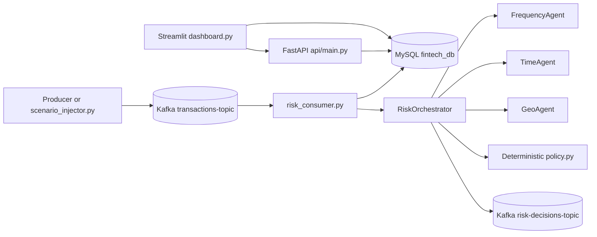

# FinTech Fraud Detection Demo

A local real-time fraud detection demo using Kafka, MySQL, deterministic rule-based agents, FastAPI, and Streamlit.

## Architecture



`risk_consumer.py` is the single transaction writer. Do not run the legacy `consumer.py` at the same time.

## Prerequisites

- Windows PowerShell
- Python virtual environment at `..\.venv`
- MySQL 8.0 with the credentials in `.env`
- Kafka 3.9.1 in ZooKeeper mode at `C:\kafka\kafka`
- ZooKeeper on port `2181`, Kafka on port `9092`

Install dependencies:

```powershell
..\.venv\Scripts\python.exe -m pip install -r requirements.txt
```

Copy `.env.example` to `.env` and set the MySQL password. `DEV_MODE=true` enables the dashboard OTP helper and `GET /dev/otp/{txn_id}`.

## Start Everything

From the `Fintech` folder:

```powershell
.\start_all.ps1
```

To start the infrastructure, API, consumer, and dashboard without continuously publishing the CSV dataset:

```powershell
.\start_all.ps1 -NoProducer
```

The script starts ZooKeeper and Kafka only when their ports are not already listening, waits up to 90 seconds for Kafka, initializes the schema and topics, and opens titled windows for the API, risk consumer, dashboard, and optional producer.

URLs:

- Dashboard: http://localhost:8501
- API docs: http://localhost:8000/docs

Stop the services:

```powershell
.\stop_all.ps1
```

## Agents

Each transaction is evaluated without using `isFraud` or `isFlaggedFraud` as decision inputs.

- **Frequency agent:** computes 5-minute, 1-hour, and 24-hour incoming/outgoing counts and amounts, unique counterparties, pass-through ratio, time since last credit, balance drain, and rate spikes. A mule pattern is scored highly; frequent activity alone remains low risk.
- **Time agent:** compares the hour and amount with the account profile. Rare hours add 40, low-history night activity adds 25, amounts above 3x the account average add 25, and a first night transaction adds 10. Cold-start accounts are capped at 60.
- **Geo agent:** uses Haversine distance and elapsed time for implied speed. Speeds above 900 km/h add 60, a foreign country adds 30, distance over 500 km from home adds 15, and trusted locations reduce risk.

## Policy

The policy is deterministic and contains no LLM decision logic:

`final_score = 0.6 * max(agent_scores) + 0.4 * mean(agent_scores)`

If at least two agents score 60 or higher, 10 points are added, capped at 100.

| Final score | Action | Transaction status |
|---:|---|---|
| 0-39 | ALLOW | APPROVED |
| 40-69 | REQUEST_2FA | PENDING_2FA |
| 70-89 | HOLD_FOR_REVIEW | HELD |
| 90-100 | BLOCK | BLOCKED |

## 2FA Flow

1. A `REQUEST_2FA` decision calls `POST /2fa/start`.
2. The API generates a six-digit OTP and stores only its SHA-256 hash in `verification_requests`.
3. OTPs expire after five minutes and allow three incorrect attempts before the transaction is held.
4. In development mode, the OTP is printed by the API and available through `GET /dev/otp/{txn_id}`.
5. Submit it to `POST /2fa/verify`; a correct OTP changes the verification to `PASSED` and the transaction to `APPROVED`.
6. The Streamlit dashboard exposes pending verifications and the development OTP helper.

## Review Queue

`HOLD_FOR_REVIEW` decisions appear in the dashboard review queue. Analysts can approve or block them, which updates `txn_status` and writes `review_log`.

## Demo Scenarios

With Kafka, the API, and `risk_consumer.py` running:

```powershell
..\.venv\Scripts\python.exe scenario_injector.py --scenario all
```

The injector creates:

- **mule:** ten senders credit `C_MULE_1` in five simulated minutes, followed by a 95% cash-out.
- **night:** forty daytime transactions for `C_DAY_USER`, followed by a 02:30 transfer at 8x the average.
- **travel:** Nagpur followed by London 20 minutes later.

The extra `scenario` field is for demonstration metadata only; agents ignore it.

## Dataset and Evaluation

PaySim does not contain real timestamps or real transaction locations. The producer and scenario tools simulate `event_time`, latitude, longitude, city, and country for the demo.

Run tests:

```powershell
..\.venv\Scripts\python.exe -m pytest -q
```

Run the offline evaluator. It uses separate `eval_*` tables and removes labels before sending transactions to the orchestrator; `isFraud` is used only afterward for metrics:

```powershell
..\.venv\Scripts\python.exe evaluate.py --reset
```

The evaluator writes `results/metrics.json` and prints precision, recall, F1, false-positive rate, average latency, and a confusion matrix.

Latest recorded metrics from `results/metrics.json`:

| Metric | Value |
|---|---:|
| Rows evaluated | 1,000 |
| Precision | 0.009 |
| Recall | 1.000 |
| F1 | 0.018 |
| False-positive rate | 1.000 |
| Average latency | 16.27 ms |
| True positive | 9 |
| False positive | 991 |
| False negative | 0 |
| True negative | 0 |
